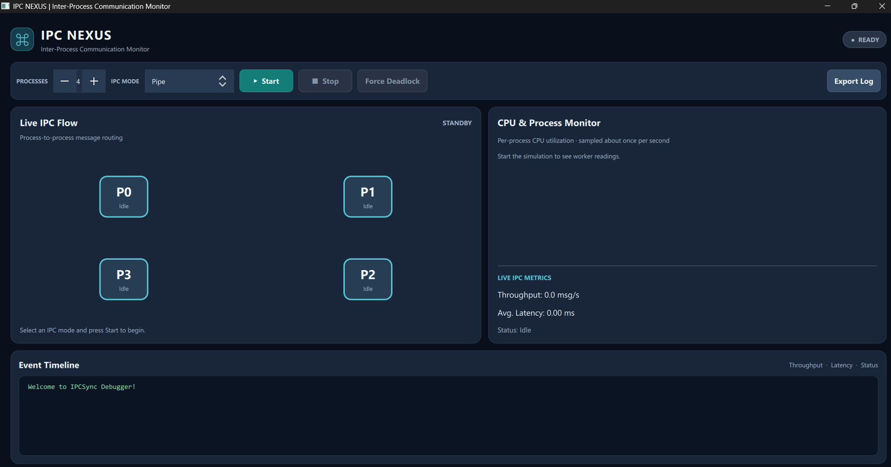
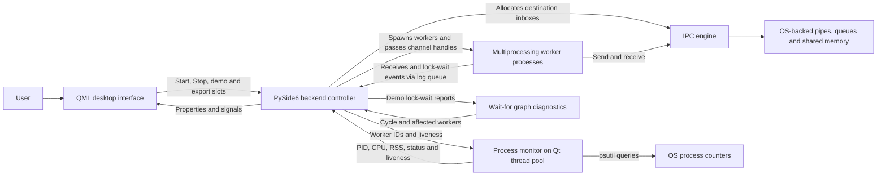
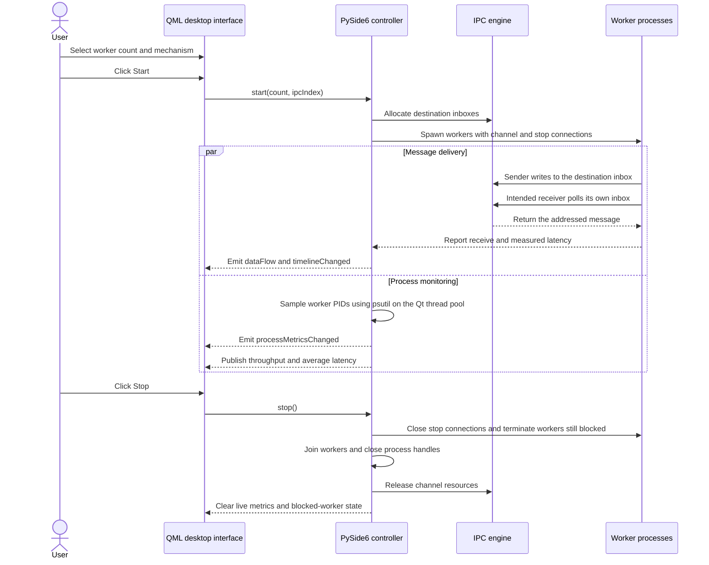
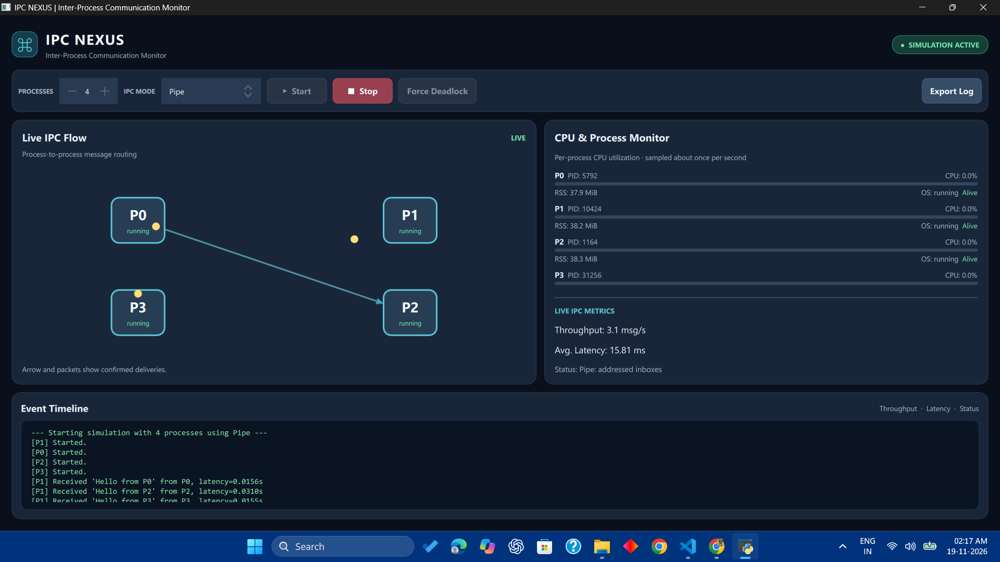
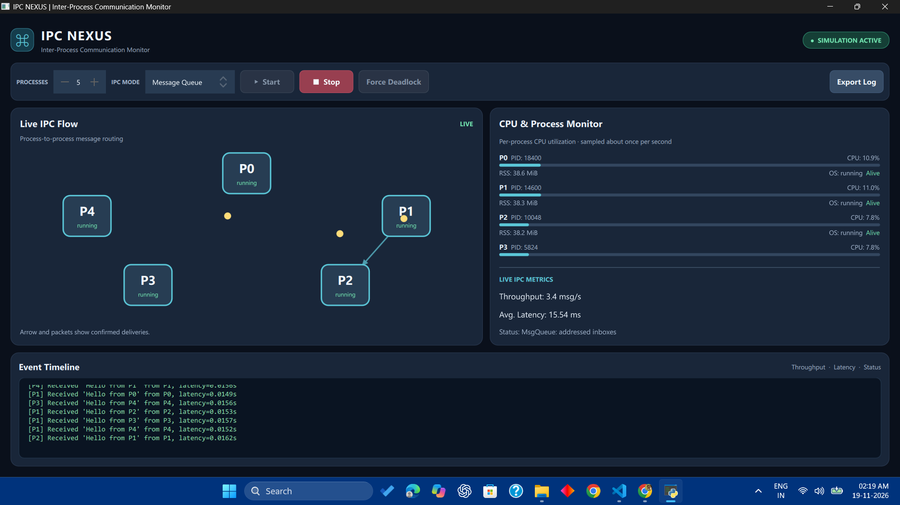
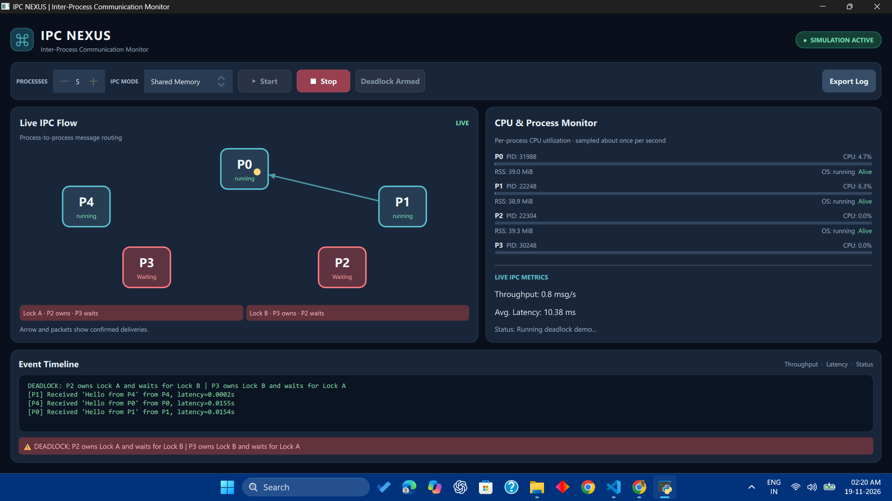
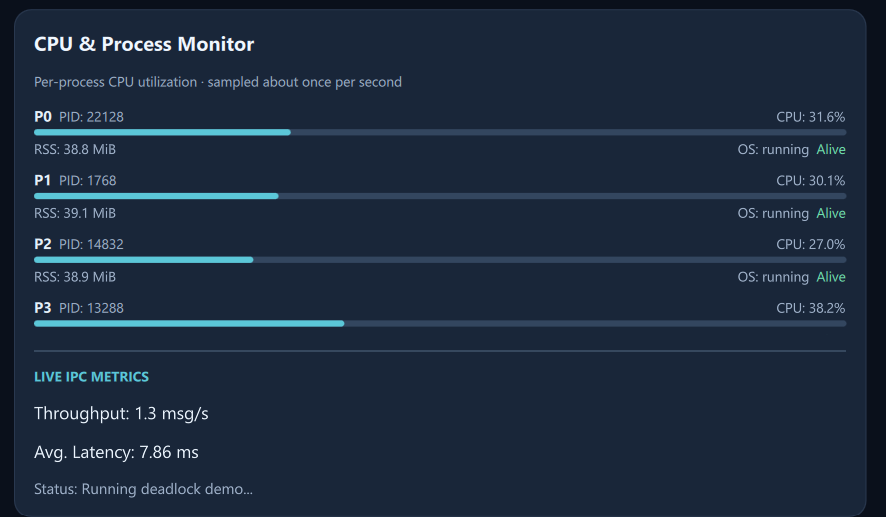
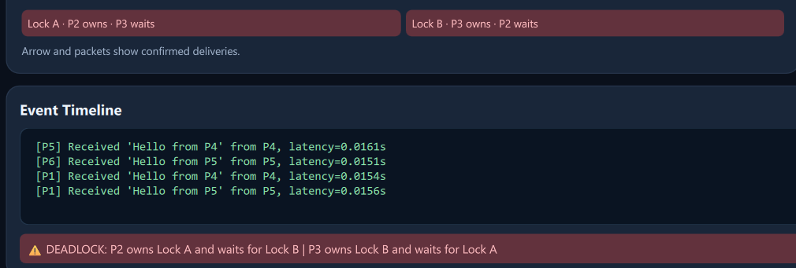
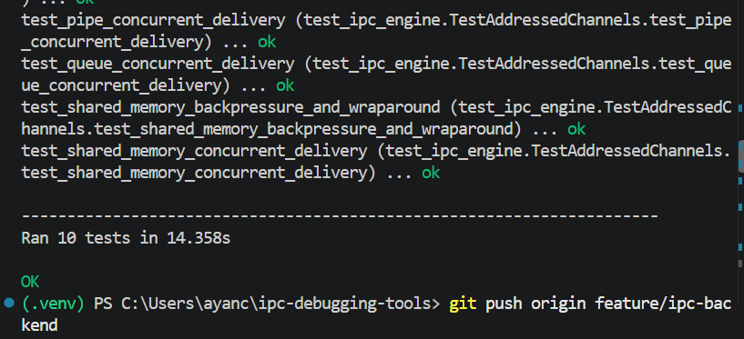

# IPC Nexus — Inter-Process Communication Monitoring and Visualization System

IPC Nexus is a Windows desktop application for observing communication between real operating-system processes. Python's `multiprocessing` runs the workers and carries their messages. PySide6 connects the controller to a QML dashboard, and `psutil` supplies live process measurements. The dashboard draws message paths after the receiving worker confirms delivery and highlights circular waits reported by the deadlock demonstration.

## Screenshots and application preview



*Figure 1. IPC Nexus at startup, with transport controls, the process monitor, and the event timeline.*

## Overview

Process isolation gives each process its own execution context and address space. When cooperating processes need to exchange data or coordinate access to a resource, they use inter-process communication (IPC) and synchronization primitives. IPC Nexus runs a small worker workload so students can observe those interactions alongside each worker's CPU utilization, memory use, and operating-system status. Switching transports lets users compare their communication and synchronization behavior under the same application workload.

## Key features

| Capability | What the application shows |
| --- | --- |
| Process-addressed IPC | A choice of Pipe, Message Queue, or Shared Memory. Each worker receives from its own destination inbox. |
| Live communication | An animated packet for each confirmed receive, a route for the most recent delivery, and a scrollable event timeline with text export. |
| Process monitoring | Logical worker identifiers, OS PIDs, per-process CPU utilization, resident memory, OS status, and liveness. |
| IPC measurements | Run-to-date delivery rate and mean latency over confirmed receives. |
| Synchronization | Serialized writers for each pipe, synchronized shared-memory buffers, and a two-lock demonstration coordinated by a multiprocessing barrier. |
| Deadlock and recovery | An alert and lock-ownership display for the P2/P3 circular wait. Stop ends the blocked workers and allows a fresh run. |

## System architecture

The desktop process owns the Qt event loop, the controller, and the channel setup. It passes channel handles to workers created with the multiprocessing `spawn` context. Workers exchange messages directly through their channel objects. A separate multiprocessing queue carries receive events and lock reports back to the controller.



| File | Responsibility |
| --- | --- |
| [`gui.qml`](gui.qml) | Desktop controls, process graph, delivery animation, process monitor, timeline, and deadlock display. |
| [`main.py`](main.py) | Desktop entry point, Qt–Python bridge, worker lifecycle, periodic sampling, timeline aggregation, and IPC statistics. |
| [`ipc_engine.py`](ipc_engine.py) | Message records and destination inboxes for the three transports. |
| [`worker.py`](worker.py) | Worker entry point, generated message workload, receive reports, and demo lock acquisition. |
| [`diagnostics.py`](diagnostics.py) | Builds a wait-for graph from reported lock waits and identifies the participating workers in a cycle. |
| [`headless_runner.py`](headless_runner.py) | Runs the same backend with a Qt core event loop and prints metrics without opening a desktop window. |
| [`build.bat`](build.bat) | Windows launcher that creates or reuses a virtual environment, checks dependencies, and starts the desktop application. |

The controller is exposed to QML as `backend`. Controls call the slots `start(processCount, ipcIndex)`, `stop()`, `toggleDeadlock()`, and `exportLog()`. IPC indices 0, 1, and 2 select Pipe, Message Queue, and Shared Memory, respectively. QML binds to Qt properties and refreshes when their notify signals fire. The `processMetrics` property is a `QVariantList` with the `processMetricsChanged` signal. The `throughput`, `latency`, `timeline`, `frozenProcesses`, and `alert` properties supply the other dashboard readings. The `dataFlow(src, dst)` signal starts an animation between the two logical worker indices.

## Application workflow

1. Launch `build.bat` from PowerShell or Command Prompt.
2. The launcher checks the environment and starts `main.py`. Python loads the QML window and exposes the backend controller.
3. Select a worker count and IPC mechanism. The desktop control accepts 2–20 workers and defaults to four.
4. On Start, the controller allocates destination inboxes, a log queue, and the demo locks and barrier if armed.
5. The controller spawns the worker processes and passes each one its channel reference and stop connection.
6. Each worker polls its own inbox and periodically sends a short generated message to another worker.
7. The receiver computes the delivery latency and reports the message to the parent through the log queue.
8. The controller samples the live worker processes using `psutil` on the Qt thread pool.
9. Qt signals update the delivery animation and notify the interface of changes to process readings, logs, and diagnostics.
10. The dashboard displays throughput, mean latency, process states, and the scrollable timeline. **Export Log** writes the current timeline to `ipcsync_log_<epoch-seconds>.txt` in the working directory.
11. To run the lock demonstration, stop any active run, select Shared Memory with at least four workers, and arm **Force Deadlock** before Start.
12. On Stop, the controller closes the worker stop connections and allows cooperative exits. It terminates workers that remain blocked, joins them, and releases the run's channel and monitoring resources.



## IPC demonstrations

### Pipe



*Figure 2. Four workers exchanging messages through destination-addressed pipes.*

### Message Queue



*Figure 3. Message Queue mode showing a P1-to-P2 delivery and the corresponding receive entry.*

### Shared Memory



*Figure 4. Workers outside the circular wait continue exchanging messages through Shared Memory.*

## IPC mechanisms — technical implementation

Each transport carries a `Message` with a logical source (`src`), logical destination (`dst`), text payload (`data`), and send timestamp (`timestamp`). Logical indices such as P0 and P1 identify inboxes. OS PIDs are displayed separately.

### Pipes

The controller creates a one-way `multiprocessing.Pipe(duplex=False)` per destination. A sender selects the destination's write endpoint and acquires that pipe's writer lock so concurrent senders write complete messages in sequence. The destination worker polls its own read endpoint and receives the serialized message when it is available. A write can block when the pipe buffer fills, so this path relies on the intended receiver draining its inbox.

### Message Queues

Each destination has a separate `multiprocessing.Queue`. A sender enqueues a message in the selected destination queue. The receiver uses `get_nowait()` on its own inbox, with an empty read returning control to the worker loop. The queue handles interprocess synchronization and transfer, and the application records delivery when the worker receives the message.

### Shared Memory

Each destination has a lock-protected ring buffer backed by `multiprocessing.RawArray` and `RawValue`. The buffer holds UTF-8 payload bytes, lengths, source indices, and timestamps. A head index and a message count identify the occupied slots. The lock protects updates to the payload and metadata during writes and reads, and the receiver reconstructs the destination index from the inbox it reads.

Each destination buffer holds **64 messages**, with up to **1,024 encoded bytes per message**. A full buffer returns a retry result, and the worker keeps the pending message for a later iteration. The channel rejects oversized payloads.

| Mechanism | Memory model | Synchronization | Characteristics |
| --- | --- | --- | --- |
| Pipe | Serialized records transferred through a connection | One application writer lock per destination | One-way endpoint pair per destination. Writes can block when the pipe fills. |
| Message Queue | Serialized records transferred through a multiprocessing queue | Queue's internal synchronization | One queue per destination. Receivers check for available messages without waiting. |
| Shared Memory | Fixed-size shared ring buffer per destination | One application lock per destination buffer | Bounded storage. Workers retry when the destination buffer is full. |

## Process monitoring and CPU interaction



*Figure 5. Sampled worker readings and run-level throughput and latency.*

| Field | Meaning |
| --- | --- |
| `index` | Logical worker index within the current run. |
| `pid` | Operating-system process ID assigned when the worker starts. |
| `cpu` | Per-process CPU utilization percentage computed by `psutil` from successive readings. |
| `memory` | Resident set size (RSS) in MiB, calculated from the resident byte count. |
| `status` | Status string reported by `psutil` for the worker. |
| `alive` | Whether the worker is still running, based on the multiprocessing handle and process checks. |

The controller requests an initial sample at startup and normally requests another about every second. CPU utilization becomes available after a prior reading establishes a baseline. The dashboard uses a dash for missing measurements. It polls the event queue on a 100 ms timer and refreshes throughput and latency on a 500 ms timer.

The operating system schedules the worker processes independently. CPU utilization summarizes CPU time used over a sampling interval. The process graph's **Waiting** label indicates participation in the reported lock cycle, and the process monitor shows the OS status independently. A blocked process may still appear as `running` in the OS status field.

Throughput is the number of confirmed receives collected by the controller divided by elapsed run time. Average latency is the arithmetic mean of the worker's send-to-receive intervals, shown in milliseconds. The receiving worker measures latency before posting the event for display. Both readings depend on the generated workload, OS scheduling, and receive polling.

## Deadlock demonstration and recovery

1. Select **Shared Memory**, set the process count to four, and click **Force Deadlock** followed by **Start**.
2. P2 acquires **Lock A** and P3 acquires **Lock B**. A two-party barrier ensures both hold their first lock before either tries to take the second.
3. Each worker reports its failed attempt to acquire the other lock and then waits for that lock while continuing to hold its first lock. The controller feeds both reports into the wait-for graph.
4. The graph finds the cycle P2 → P3 → P2. The dashboard highlights the two blocked workers and shows the ownership and wait relationship for each lock.
5. Click **Stop** to terminate the blocked workers and clear the alert. Click **Start** again to launch a new run with fresh IPC resources.

| Worker | Holds | Waits for |
| --- | --- | --- |
| P2 | Lock A | Lock B, held by P3 |
| P3 | Lock B | Lock A, held by P2 |



*Figure 6. The lock cards and diagnostic alert identify the owner and waiter for each lock.*

Cycle detection applies to the instrumented demo locks and participating workers. The controller draws the cycle from the events reported by those workers.

## Installation and launch

Use Windows with Python 3 available through the `py` launcher or as `python` on PATH. The runtime dependencies in [`requirements.txt`](requirements.txt) are PySide6 6.5 or later and psutil 5.9 or later. Missing packages must be available from a configured package index or pip cache.

```powershell
git clone https://github.com/AyanChangdar/IPC_visulaizer.git
cd IPC_visulaizer
.\build.bat
```

The launcher changes to its own directory, creates `.venv` if needed, installs requirements with that environment's Python, and launches `main.py`. It displays an error and pauses if environment setup, dependency installation, or startup fails. To launch directly after setup, run the following from the project directory.

```powershell
.\.venv\Scripts\python.exe -B main.py
```

## Headless runs

Run a four-worker Pipe smoke test or the Shared Memory deadlock demonstration from the project directory.

```powershell
.\.venv\Scripts\python.exe -B headless_runner.py --procs 4 --seconds 5 --ipc pipe --stdout
.\.venv\Scripts\python.exe -B headless_runner.py --procs 4 --seconds 5 --deadlock --stdout
```

The runner prints process measurements during execution. `--ipc` accepts `pipe`, `queue`, or `shared`. `--deadlock` selects Shared Memory and needs at least four workers. `--stdout` prints the final timeline to the console. With the default output option, the runner writes the timeline to a log file in the working directory.

## Testing and validation

Run the backend suite with the existing virtual environment.

```powershell
.\.venv\Scripts\python.exe -B -m unittest discover -s tests -v
```

The tests exercise concurrent addressed delivery across all three IPC mechanisms, shared-memory buffer limits and wraparound, process measurements and exits, repeated Start/Stop, and recovery after a circular wait. For desktop verification, run each mechanism with four workers and match the animated route to the timeline. Then run the deadlock demonstration and verify that a fresh run delivers messages after Stop.



*Figure 7. Backend unittest summary showing 10 passing tests.*

## Scope and limitations

- The dashboard monitors workers spawned by IPC Nexus. Their message contents and destinations come from the built-in demonstration workload.
- The displayed timings describe the current run. They depend on the machine, scheduling, worker count, and message workload, so they are useful for observing behavior during a demonstration.
- The Shared Memory transport has bounded storage and retries when full. Stop ends the run and discards channel state, including pending deliveries.
- Deadlock diagnostics cover the two-lock demonstration. The process monitor reports OS counters and status on the sampling cadence described above.
